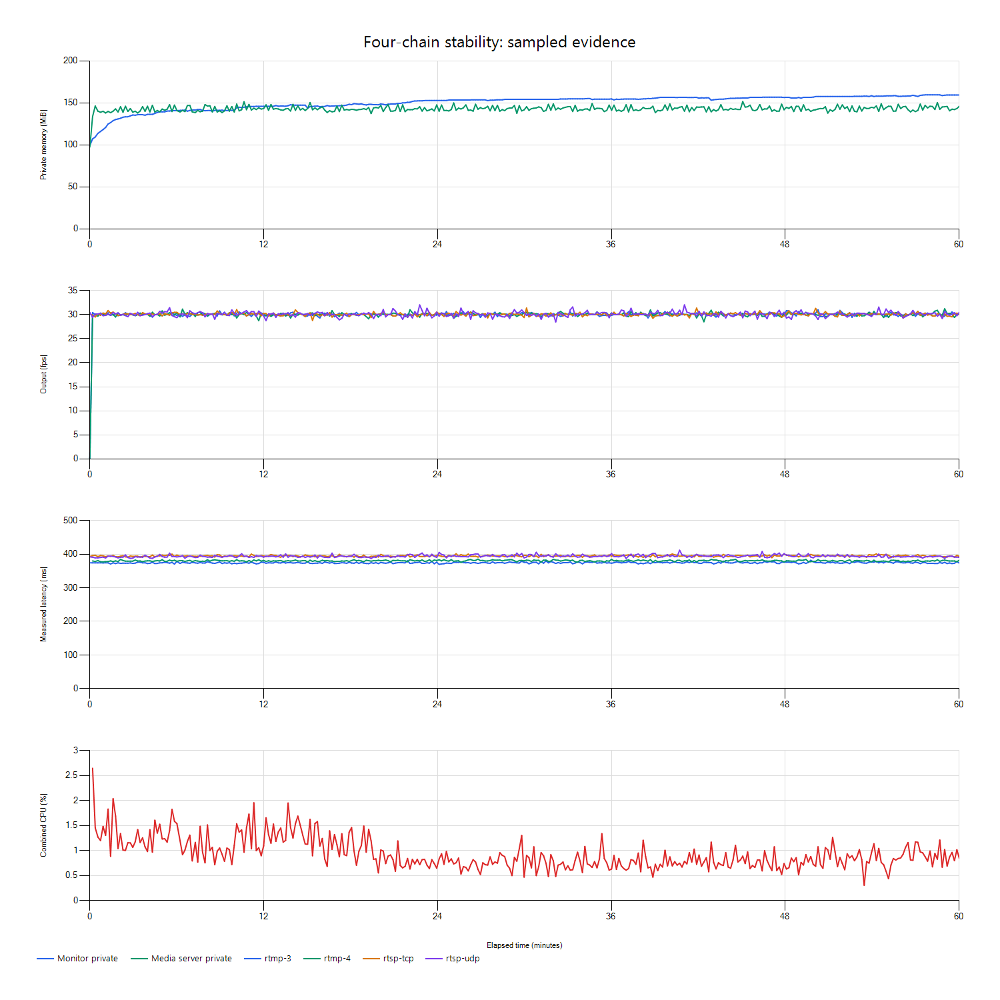

# 四路一小时稳定性验收报告

> 同步说明（2026-10-28）：默认演示已恢复1080p30含音频合成素材；普通24fps及视频单轨素材另有配置。UDP大帧问题已做跨循环修复回归；历史实验条件与证据保持原样。当前状态、启动、持久化及未完成项统一见[当前版本与使用说明](./当前版本与使用说明.md)。带日期的旧计划和阶段结论不代表最新状态。

> 2026-10-28。运行／资源与指标有效率达到事先记录的工程门槛；质量事件和归因限制单列保留，最终现场签收不能省略这些限制。

## 1. 结论

本机四条完整1080p30含音频链路连续运行一小时，未观察到崩溃或异常重连，资源保护未触发。平均输出约29.985～29.994fps，指标有效率、稳态内存变化及CPU占用满足[预先记录的规则](./四路长测执行计划.md)。

采集中有**3个短冻结时段、共6条链路冻结记录，89帧已证实呈现端迟到丢弃，以及UDP路26帧归因受限的缺失**。这些是真实质量记录，不能因平均帧率达标而删除；本报告也不证明不存在任何内存泄漏或所有环境下均无短暂停顿。

自动评估保留`review_required`，因为发现了丢弃与未知缺失。人工复核结论为：**本轮运行／资源与监测有效率判据达标，附已记录质量事件及观测边界**。事件表明程序能持续检测、持久化并恢复输出；缺失的解码逐帧观测、系统调度追踪不能由事后猜测补齐。

## 2. 负载、时间与安全收尾

- 北京时间：2026-10-28 **09:59:35～10:59:35**，采集时长3600.099秒，357次快照，采集失败0次；采样间隔中位数10.063秒、范围9.807～13.115秒。
- 4条完整链路：RTSP UDP、RTSP TCP、RTMP第3／4路；源为本机`sample-3m.mp4`，原始H.264／AAC、1920×1080、30fps。程序管理推流、MediaMTX转发、拉流、完整解码、实际软件输出。未加入SEI／水印等检测标记。
- 软件观测像素缓存320×180；每路排队20MiB／96帧、全局CPU像素64MiB，解码线程每路1个。该预算不等于整个进程内存上限。
- 本轮未打开额外视频预览、未运行八路、没有主动故障注入。开始时本机磁盘可用约122.54GiB。
- 采集代码版本`3a59435`；运行二进制SHA-256：`5193082254535C2BFECB642C04970A6ADDE204E131694BE5ED9D040E0150294F`。分析工具后续编写，没有修改运行中的媒体程序。
- 应用私有内存512MiB、服务器256MiB、合计CPU归一20%连续两个区间为提前停止保护；应用另有62分钟独立watchdog兜底。正常采集到期按PID／路径／创建时间自动关闭应用及服务器，结束后实查两者进程数均为0。
- 全量逐行审计3,238,750条原始JSON记录，解析错误0；采样中的原始记录丢失计数为0。该检查验证现有文件可解析，不将它夸大为每个未观测阶段都有完整证据。

API首末请求时间差为3599.597秒，不能将其原值改写为3600。采集开始／结束时间差达到3600.099秒，且四路原始源端释放跨度均超过3607秒、实际呈现跨度均超过3604秒，支持本次连续运行超过一小时；跨度包含正常启动／收尾，不冒充整个跨度内没有短冻结。

## 3. 帧率与有效率

排除前30秒启动期；近1秒持久化记录每路3543条。十秒采集有利于看长期趋势，以下同时核对更密集的持久化记录，避免漏过短暂停顿。

| 链路 | 平均输出fps | 持久化点达到28fps比例 | 持久化最低fps | 延迟有效率 | 同步有效率 |
|---|---:|---:|---:|---:|---:|
| RTSP UDP | 29.985 | 99.915% | 6.107 | 100% | 99.944% |
| RTSP TCP | 29.994 | 99.972% | 7.026 | 100% | 99.887% |
| RTMP 3 | 29.994 | 99.972% | 7.026 | 100% | 99.972% |
| RTMP 4 | 29.994 | 99.972% | 7.269 | 100% | 99.972% |

启动后近1秒记录没有零fps点，但确有短时低帧率及冻结；“没有采到零fps”不代表没有亚秒停顿。十秒快照中四路均达到28fps，延迟／同步有效率均为100%，这组稀疏快照不能替代上表。

十秒快照的延迟中位数约为393.50、394.77、374.45、380.21ms；同步偏差中位数约−9.85、−9.15、−12.72、−12.45ms。接收连接序号全程均为1；启动后播放代次分别固定为2／2／4／4，没有混用重连代次。未观察到持续的大幅延迟／同步漂移。

## 4. 资源与内存趋势

| 项目 | 实测 |
|---|---:|
| 应用私有内存峰值 | 159.55MiB |
| MediaMTX私有内存峰值 | 151.61MiB |
| 第5分钟后应用私有内存中位数 | 154.25MiB |
| 稳态初段5分钟内存中位数 | 141.03MiB |
| 末段5分钟内存中位数 | 159.08MiB |
| 初末中位数变化 | +18.05MiB |
| 第5分钟后线性增长斜率 | 0.318MiB／分钟 |
| 应用平均CPU | 0.548% |
| 服务器平均CPU | 0.388% |
| 合计CPU采样峰值 | 2.644% |
| 第5分钟后句柄范围／结束值 | 627～630／627 |

CPU按20个逻辑处理器归一。增长低于预定的64MiB中位数变化及0.5MiB／分钟调查门槛，曲线后半程明显放缓，有波动回落。仍未做堆分配追踪，不能据此严格证明不存在任何泄漏；本轮没有温度数据。旧八路长测与本次负载不同，不计算虚假的直接降幅。

下图为十秒采样曲线，短冻结的详细情况以下节每秒记录及原始事件为准。

## 5. 质量事件复核

### 呈现丢弃及冻结

原始`presentation_dropped`记录与唯一源帧ID核对：UDP 27帧、TCP 21帧、RTMP 3为21帧、RTMP 4为20帧，共89帧，原因为`output_deadline_missed`。这表明帧在本程序呈现端错过截止时间；没有算成网络丢包。具体为何发生调度／绘制停顿，现有记录缺少系统级线程追踪，不能强行断言操作系统、散热或某个函数是根因。

冻结记录共6条，按共同时间聚合为3个时段：

| 事件入库北京时间（约） | 影响链路 | 无新输出间隔 |
|---|---|---:|
| 10:09:35 | UDP | 465.937ms |
| 10:14:34 | UDP | 451.010ms |
| 10:19:53 | 四路同一呈现终点时刻恢复 | UDP 813.593ms；其余各797.450ms |

事件保留起止单调时间、动态门槛约182～184ms及超阈值时长。入库时间可能晚于实际呈现事件，不能将其当作物理屏幕时钟。当前系统保留了低于1秒严重告警门槛的短冻结，没有以“没严重告警”否认它们。

### UDP未知缺失

两次成熟窗口各出现13帧未知，原始记录按ID去重后共26帧。24帧有接收匹配记录但未见相应呈现记录，另2帧未见接收匹配；未找到这些ID的明确丢弃事件。窗口内未见id=0的额外视频输出或重复呈现ID，可排除这两种已记录现象，但仍不足以断定每个缺失的实际原因。

中继门后RTP序号丢失计数为0。这只说明该观测点没有确认序号缺口，不证明最终播放器socket、解复用或解码阶段绝无丢失。当前未逐帧保存解码完成／全部解码返回状态，无法将“有接收匹配、无输出”的24帧进一步确定为某一种解码原因；2帧的传输缺失与关联缺失也不能凭计数区分。

本次源端每路循环12次，未知帧集中于两次循环后约1秒的时段；时间相关性不证明循环实现必然导致丢失。保留`unknown_missing`、证据和上下界符合既定口径，不改为0或全部归为网络原因。若要进一步减少这一限制，应补充解码边界和接收末端观察后再有针对性复现。

## 6. 判据与后续

| 预先判据 | 本轮状态 |
|---|---|
| 连续运行一小时、无崩溃、采集完整 | 达到，原始输入及呈现时间跨度均支持 |
| 启动后平均至少28fps、至少99%记录达到28fps、无零输出记录 | 达到；短冻结仍按原始事件公开 |
| 延迟／同步有效率至少95% | 达到，使用更密集持久化记录仍满足 |
| 资源保护及稳态增长边界 | 达到，保护未触发；不能代替严格堆泄漏分析 |
| 丢弃／未知／冻结逐项核查 | 完成证据核查，具体系统停顿根因和26帧细分原因仍受观测限制 |
| 到期结束检测程序及媒体服务器 | 已实查退出 |

本次可作为基础四路的一小时运行稳定性证据，附以上质量事件与归因限制。原生Edge／Chrome现场兼容性、物理断网现场演练和最终交付签收仍需确认；内置Chromium与本地依赖就绪的既有证据保留。八路历史长测仍未通过，加分项后置。

精简证据在`docs/evidence/2026-10-28/stability-four/`，完整采集与原始记录保留本机`artifacts/stability-20261028-095933/`和`data/observations/`。分析脚本为`analyze-stability.ps1`、`review-stability.ps1`、`audit-stability.py`，图表使用Windows自带Charting生成，没有为分析下载新依赖。期间未修改或重新构建正在运行的媒体程序。
