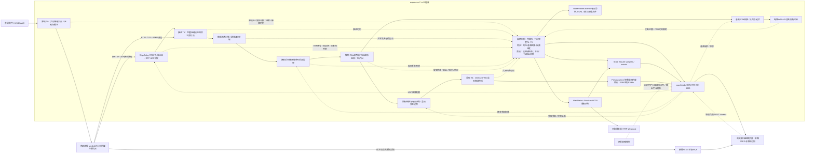

# AVQualityMonitor 系统设计文档

> v1.0，2026-10-29，按程序基线63d6307统一修订。本文描述实际模块、数据流、接口和测量口径；当前暂停功能改动。历史设计由Git保留，实施存在不等于最终验收通过。

## 1. 目标、部署与边界

Windows x64本机运行，C++20、MSVC 14.44、CMake／Ninja。主程序管理每条文件源的推流、拉流、解码、软件音视频输出和质量检测；外部MediaMTX进程接收和转发。四路表示4推＋4拉的4条独立完整链路，基础负载为4条1080p30含AAC音频；8条是加分负载。

普通H.264／AAC素材不植入水印、SEI或声画标记。源素材自身同步为输入前提；源端时间是文件按实时节奏释放的本机单调时刻，不包含原素材制作时采集编码。测量终点为WIC像素完成／WASAPI设备消费，不是物理屏幕发光、扬声器声学到达或浏览器展示。

独立direction=pull只拉取已存在上游；缺源端参考时绝对端到端延迟和精确源帧损失不可测。has_audio=false时同步不适用，不能显示0ms正常。当前工作副本可能采用用户自选视频单轨素材，正式负载使用config/stability-four.json，不依赖日常配置恰好满足验收条件。

## 2. 总体架构与实际媒体路径

RTP中继编译在主程序内，固定连接本机MediaMTX8554；8555是RTSP会话入口，媒体走协商的UDP端口。它转发原始RTP／RTCP、组装H.264边界用于观测，可按配置实际阻断视频数据报，不重编码。它只覆盖服务器到检测端这一段，不代表源端到服务器绝不丢包；多一次转发开销包含在主延迟中。RTSP TCP／RTMP不经此中继。

检测直接使用内存旁路事实，JSONL是审计落盘，不能将落盘文件读取画成实时检测必经路径。MediaMTX不提供本项目假想的逐帧质量接口。注入真值另存*-truth.jsonl，仅供测试对照，检测不读取随机决定作为答案。

HTTP-FLV加分实现位于src/http/flv.cpp：从已有发布流提取压缩媒体重封装，HTTP-FLV接收仍进入同一Chain检测路径；会增加适配拉流负载与启动探测延迟。WebRTC未实现。图中未把这些可选接入误画为基础直连能力。

## 3. 源码模块与真实接口

| 目录／类型 | 实际职责 |
|---|---|
| src/app / Application | 组合配置、Chain、Output、RtspRelay、Store、ObservationJournal和Services；主输出循环及约1秒tick |
| src/media / Chain | 每路发布／接收线程、普通素材关联、帧账本、调度队列、故障配置、snapshot与tick |
| src/media / RtspRelay | 本机RTSP代理、RTP／RTCP转发、序号重排统计、视频帧边界及UDP故障门 |
| src/detection/core | 公式、SyncSample拟合／阶跃分段、FrameRecord结局、成熟缺失判定、LossWindow、FreezeTracker、AlertState、RtpSequenceTracker及像素预算 |
| src/playback / Output | 主线程Direct2D WIC输出、逐路音频设备／PCM消费映射、select_audio |
| src/playback / PreviewMirror | request／capture／latest／clear；按需最新画面与JPEG缓存 |
| src/app / Services | 异步command／command_status控制队列、notify通知队列与有限重试线程 |
| src/storage / Store | sample／event／history／events／prune；SQLite互斥访问 |
| src/storage / ObservationJournal | 有界append异步写入、stats丢记录计数、分段、flush及stop |
| src/http | 本机API、静态页面与可选FLV重封装 |
| src/config | parse_settings参数范围校验；配置读写与revision由Application／HTTP协作 |
| web / tests / scripts | 离线页面、核心／集成验证、构建启动与限时收尾 |

事件使用JSON、SourceUnit、FrameRecord、PipelineTimes等实际类型。SourceUnit保存源身份与签名，FrameRecord保存阶段时间和互斥结局；新增协议需接入原始媒体及身份时间映射，不能用成品质检统计替代检测。

## 4. 并发、生命周期及资源

Application.chains_mutex保护可追加的链路注册表；各线程通过chains_copy取得共享指针快照后立即释放注册锁，避免新增时vector重分配与遍历冲突。POST新增在配置互斥下分配唯一ID／路径、保存配置、注册Chain并排队启动；既有链路不停止。Output按链路对象身份持有音频设备／重试状态和所选监听，新增或关闭不按数组下标复用其他链路设备；位图布局比较对象身份及顺序，变化后清理旧预览，下一次真实输出再产生新画面。

每路一对publisher_／receiver_线程，RTSP中继有接入及会话轨道工作线程；Output拥有软件输出和设备。HTTP工作线程提供API及JPEG编码，Services分别执行控制与通知；ObservationJournal单写入线程。chain.mutex保护本路账本／队列，config_mutex保护应用配置；IO和图像预算有边界，避免无限积压。

启动创建session和playback_generation；连接重建、源端重建或停止切换代次并清空映射、队列、设备采样和预览。输出携带代次，旧回调不更新新指标。停止managed路结束其推拉和检测，其他路继续；direction=pull只能停止本程序接收者。关闭网页／预览不结束主检测，停止脚本核对PID、路径和创建时间后收尾。

默认完整解码1080p，CPU像素缓存按320×180等比例转换；每路96帧／20MiB、全局64MiB像素预算，每解码器1线程。队列／全局预算不足或到期过晚会实际丢弃并记呈现原因，不阻塞接收线程。预算不等于整个进程内存，JPEG、FFmpeg和设备另有开销。构建默认2并行任务；媒体测试设硬截止、资源保护和finally清理，办公本不随意重跑长测。

### 4.1 关闭页面与资源身份

页签×及顶部关闭页面调用异步close命令，先等待本路推拉线程结束，后在配置／注册表互斥下保存移除、递增revision、注销对象；不持有注册锁等待IO。仅关闭元数据与运行对象，Store历史、日志及素材保留，历史路由不依赖find活对象。空配置允许0条，重启后显示空工作区，可再次新增。next_chain_index从现有路径迁移并持久递增，避免旧请求或历史身份被新页面复用。

音频map键与原子监听选择均为共享链路身份；注销只取消该对象的监听，其他对象不因位置移动而重置设备。布局比较shared_ptr顺序，关闭后即使又新增到相同数量也不会保留错误旧位图。输出和音频循环的共享快照保证注销时在途操作安全，旧代次回调拒绝更新。

前端关闭任务完成后重新读注册表与配置，自动选邻页；空时隐藏详情、清理预览、显示新增入口。关闭失败保留真实状态，不先删前端标签；轮询序号阻止旧响应恢复已关闭页面。停止按钮仍保留页面，与close区分。验证见关闭链路页面验收记录。

## 5. 源收关联与时间基准

源端每个媒体单元生成内部ID、QPC可比较的单调时刻now_us、源媒体时间、压缩签名。音视频共用ID序列，视频ID不必连续；丢帧按源视频记录核对，不用ID差值计数。H.264仅规范化VCL负载的SHA-256，忽略Annex-B／AVCC分隔和配置NAL；AAC使用原始负载。接收先匹配签名，多个候选以已验证PTS偏移消歧；仍不唯一则保留不可判定。UDP有独立损伤边界与经验证PTS时可恢复匹配，不能只按顺序硬配。

音视频PTS分别按time_base换算微秒，再映射回统一源媒体轴，保留原始音视频偏移；PTS不是采集墙钟。FFmpeg opaque_ref只在接收端进程内传递已关联ID，不经过服务器；最佳努力时间戳作为本地后备索引。重连清理偏移和候选，文件循环保持连续封装时间，不更改媒体负载。

WASAPI设备位置除以设备报告频率映射到已提交PCM段和源媒体时间，设备读数配合QPC对齐视频事件。仅在同代次、设备读数足够新且PCM段有效时计算；欠载、静音填充、无映射或过期不填零。

源端T0在按DTS实时调度及签名准备后、发送记账之前记录。接收T1是av_read_frame成功返回后的第一条语句，早于哈希／锁／查找；它不是网卡到达，包含接收解封装和组帧等待。publish_write另存发送调用前后时刻，返回不代表远端收到；签名向量预分配容量，不改变媒体内容。

## 6. 指标、窗口与阈值

| 指标 | 计算／观测位置 | 窗口与单位 | 默认阈值与限制 |
|---|---|---|---|
| 传输延迟（卡片／首图） | 同帧完整压缩帧返回T1减源端实时释放T0 | 近1秒匹配接收样本均值，ms | 无参考／无近期样本为空；含封装与组帧，不是纯网络，现有告警仍用完整端到端 |
| 端到端延迟 | 同帧WIC成功EndDraw并锁定像素的时刻减源端实时释放时刻 | 近1秒有效样本均值／最大值，ms；每秒快照 | 400／1000ms预警／严重，项目策略；无参考／无新输出为空 |
| 音画偏差 | 视频完成时刻的音频源媒体进度减该视频源媒体进度 | 近1秒中位数，ms；正值音频超前 | 超前45／90ms、滞后125／185ms，BT.1359基线参考；不测素材语义同步 |
| 同步漂移 | 连续有效同步样本线性拟合斜率 | 近60秒，跨度>48秒、样本>40，ms/s | 绝对斜率>1持续30秒；残差>15ms不发布；缺口>0.5秒／时间倒退／代次变化切段 |
| 视频丢帧 | 源帧互斥结局汇总，不用10Hz网页图片计数 | 默认源年龄5～15秒的10秒成熟集合，%／帧数 | 1／5%，项目策略；unknown保留已证实下界及可能上界；pending不进入确定分母 |
| 连续丢帧 | 按源媒体时间排序的结局 | 当前成熟窗口及当前接收连接最大连续帧数 | 重连新建连接统计，历史保留 |
| 冻结 | 实际新软件画面输出间隔 | 持续时长ms／事件数 | max(3×最近30帧平均间隔，平均间隔+150ms)，1秒严重；静态内容持续有新帧不算冻结 |
| UDP包损失 | 中继转发门后RTP序号观测，64包重排后确认 | 接收连接累计包数／% | 只覆盖此段，不等于视频丢帧；TCP路径不伪造RTP包损失 |

一般告警越界持续3秒、恢复3秒；漂移和冻结有专门规则。阶跃确认需偏离基线>50ms、同方向至少3样本且持续100ms，候选期间不发布漂移；单帧真实抖动不裁掉。非标准强制数值均是项目策略，参考和选择依据见需求基线第7节。

### 6.1 同帧延迟分段与字段

原latency_ms继续表示源端释放→WIC实际输出的完整端到端延迟，保留历史与现有告警口径；卡片和主延迟曲线改用transport_ms。它直接测量源端实时释放T0到av_read_frame返回完整压缩包后立即记录的T1，包含推送、服务器／协议／解复用等待，不是物理网线单向耗时；不能靠不同样本的两个均值相减取得。

每个关联视频单元记录六个真实单调时刻：T0源端释放、T1接收返回（哈希匹配前）、T2a调用avcodec_send_packet前、T2b成功返回、T3为avcodec_receive_frame成功产出对应画面、T4为WIC完成。EAGAIN重送以最终成功调用的起点为T2a；异常与丢弃没有完整分段则为空，不补猜测。

| API字段 | 毫秒公式 | 展示 |
|---|---|---|
| transport_ms | (T1−T0)/1000，近1秒全部匹配接收样本均值 | 卡片／趋势图传输延迟，包括未最终呈现的接收帧 |
| receive_to_submit_ms | (T2a−T1)/1000 | 接收→送入解码前，包括关联处理 |
| decoder_ms | (T3−T2a)/1000 | 解码阶段，包含send_packet内的同步工作及重排序／取帧等待，不冒充CPU执行时间 |
| submit_call_ms | (T2b−T2a)/1000 | 送入调用本身，属于decoder_ms子集，不重复相加 |
| decode_ms | (T3−T1)/1000 | 接收→解码完成 |
| post_decode_ms | (T4−T3)/1000 | 转换、调度、排队与实际绘制，包括注入延后 |
| receiver_processing_ms | (T4−T1)/1000 | 完整接收后处理 |
| pipeline_transport_ms／pipeline_total_ms | (T1−T0)/1000／(T4−T0)/1000 | 完整六时刻同组样本均值，便于核对分段和；与transport_ms的样本集合可能不同 |

完整分段使用近1秒已实际呈现且六时刻单调、有唯一身份的同组样本，pipeline_sample_count公开数量。transport_sample_count公开独立传输样本数量；预热、无源参考、无近期样本／缺字段时返回null。新字段随快照写SQLite，旧历史没有新字段就空，不将原端到端值改名。

原始pipeline_timing保存六时刻、帧ID和代次；source_release、received_matched、decode_submission（含call_started_us）、decoded_output与software_present独立核对。验证见scripts/validate-chain-pages.ps1和scripts/audit-pipeline-timing.py；实测与历史版本范围见测试总账。

### 6.2 接收后关联子段

receiver_association保存received_us、hash_started_us、hash_done_us、lock_requested_us、lock_acquired_us、match_started_us、matched_us七个真实时刻。近1秒已匹配视频包统计如下，缺样本null：

| API字段 | 口径（微秒差除1000） |
|---|---|
| receive_hash_ms | hash_done − hash_started，含规范化与SHA-256 |
| receive_lock_wait_ms | lock_acquired − lock_requested |
| receive_match_ms | matched − match_started，含关联及匹配事实记录 |
| receive_bookkeeping_ms | received→hash_started、hash_done→lock_requested、lock_acquired→match_started三个实际间隔之和 |
| receive_association_ms | matched − received，上述四项同组均值之和 |
| association_sample_count | 该组有效样本数量，独立于完整呈现分段样本 |

关联完成到提交前仍有故障判断等工作，association不是receive_to_submit的全部。不同样本集合不能相减推断阶段；原始事实字段由audit-receive-timing.py核对。UDP的rtp_boundary_observation增加last_packet_us和marker_seen，前者在recvfrom返回后立即记录；仅帧末标记且包转发完整、身份唯一的记录用于帧末到接口返回的对照。时间戳切换或结束冲刷不伪造marker完整边界。

当前素材下RTSP多约一帧等待的观测与源码解释见[计时记录](./预览与接收计时核对记录.md)。这不是协议或FFmpeg规定固定等33ms，也未单独测得所有解析内部耗时；不人为扣减或关闭必要解析来制造更低延迟。

## 7. 解码与丢帧归因（当前实现）

结局互斥，同一源帧只计一次。pending仍在等待；presented是实际输出完成，收到损伤数据但仍有解码／呈现的帧不能再记为解码缺失。

| 结局 | 证据与含义 |
|---|---|
| source_skipped / send_failed | 源端跳过的预留结局／发送明确失败；前者没有当前网页源跳帧注入入口，不冒充已测能力，也不算接收网络损失 |
| transport_lost | 已有UDP帧损伤证据且未见可能对应的歧义输出，但不能证明已提交解码的传输阶段缺失 |
| receiver_discarded | 接收完整压缩单元后、解码前实际主动丢弃的观测 |
| decode_failed | avcodec_send_packet明确拒绝，记录返回码及损伤证据；EAGAIN不是此类失败 |
| damaged_decode_no_output | 同代次成功提交、独立UDP损伤证据、提交后超过配置等待且无解码输出、无可能对应的未关联输出 |
| decode_after_input_loss | 同样的成功提交超时未产出，且此前有实际接收丢弃／受损输入的ID上下文；说明阶段与先后关联，不声称已解析具体参考图依赖 |
| decode_no_output | 已提交超时未产出但没有直接损伤／输入缺失上下文，明确阶段，具体根因未证明 |
| presentation_dropped | 已解码后主动丢弃，或输出队列预算／迟到／清理等实际记录 |
| unknown_missing | 缺少上述证据、旧代次不确定结局或有可能对应的未关联输出，保留未知范围 |

FrameRecord保存decode_submitted_us、decode_generation、preceding_input_loss_id以及receive／decode／present时间。成功送解码后独立等待resolution_timeout_ms（默认5秒），不是只按源帧年龄认定；刚提交、B帧正常等待和已解码排队不算解码失败。超时结局写frame_resolution，含源ID、提交时间、代次、先前缺失ID和损伤标记。极晚输出若仍成功关联，会撤销这三种未产出结局并按真实输出更新。

receive_frame的EAGAIN记录为needs_input，EOF为end_of_stream，其他负值为error；非逐帧返回错误不能直接指定某一帧根因。send_packet出现EAGAIN先排出已有输出再重试同一包，不静默丢输入。接收丢弃或损伤设置输入缺失上下文；成功输出后续无错误的关键帧才清理该上下文。它是保守的恢复边界，不等于已实现完整H.264参考依赖分析。

冻结由FreezeTracker在每次WIC完成后记录新帧间隔，连续丢失则按源媒体顺序的成熟结局统计；两者不靠重新给接收画面连续编号。RTP序号跨16位回绕并等待64个序号位置处理乱序后确认缺口，连接末尾／无后续包时不能立即确认所有尾部损失。当前没有底层TCP分节丢失／重传统计，RTSP TCP也未导出同等RTP序号统计；这是观测未实现，不是TCP不会丢包。TCP重传恢复后的数据可完整到达，仅延迟／冻结增加。

随机30%是每个候选压缩单元的概率，不是最终未呈现率30%。丢参考／关键输入可能导致更多解码未产出；解码后呈现丢弃则保留解码参考。故障切换后成熟窗口仍混有旧样本，应等窗口滑出。用户所说“部分丢包无法解码”仅在真实数据报损伤证据存在时采用损伤分类，不能将完整压缩单元主动丢弃改名为网络丢包。

### 7.1 协议与方向的证据差异

| 路径 | 源端可取得的信息 | 接收侧判定与不能推断的内容 |
|---|---|---|
| RTSP UDP | 原始媒体单元、哈希、释放／发送调用时刻及结果 | 中继RTP序号、帧损伤及接收／解码／呈现结局；只覆盖服务器到中继观测段，不能据此排除源到服务器损失 |
| RTSP TCP | 同上，发送返回只代表本地调用结果 | RTP仍由FFmpeg接收解析，但未独立导出序号／TCP重传统计；按源收及呈现事件定位帧阶段，不能将所有未匹配归网络丢包 |
| RTMP | 发布压缩媒体包及源参考；不采用RTP序号口径 | 依据接收媒体内容、解码和呈现账本判断帧结局；无底层TCP分节丢失统计，不能套用UDP包率 |
| 外部独立拉流 | 本程序没有该源的可靠释放与应有源帧账本 | 可接收解码、展示流状态及软件输出健康；绝对端到端、精确源帧丢失及缺少可信映射的同步不编造数值 |

源端观测只为完整链路参考与故障解释，未另做已取消的“推流侧独立质量观测”加分项。发送函数成功不代表服务器收到或接收端呈现；TCP可能丢底层分节并重传恢复，只看最终压缩帧不能反推重传数量。故障注入位置与各协议边界见使用说明，不能将随机决策直接回填归因。

## 8. 预览、监听与主测量分离

每个页面仅含本路卡片、三张图、检测预览和原流对照；页面标签切换不停止其他链路，默认选中一条，新增页面可选RTSP TCP／UDP或RTMP、名称、素材和音频声明，最多8条。页面保留已有配置中的各条链路，不自动停掉用户任务；从单路起步可使用config/single-chain.json。

检测预览从WIC绘制成功后的本路实际内容矩形捕获，绘制与镜像共用整数矩形，排除布局留黑；最多100ms一次、2秒需求租约，HTTP线程将像素编码JPEG并缓存最新结果，没有第二次服务器拉流／解码。四路16:9实际内容通常500×281，单路1000×563，网页宽度占满容器、高度按比例自适应；不是1080p原生浏览器播放。HTTP携带代次、帧ID、呈现时间、序号、尺寸和新鲜度；无新帧204，浏览器保留最后图并提示冻结，停止／重连清理旧图，关闭中止轮询并释放URL。

主测量时间在快照复制之前记录，但预览开销仍可能影响调度，需实测。WASAPI本机监听只选择音量，不新拉原流；JPEG的额外展示延迟不计入主指标，不宣称浏览器画面与本机声音已同步。显式原流对照另走MediaMTX按需HLS，默认静音，不能展示检测端注入后的输出。

## 9. 配置与实际API

链路字段包括id、alias、enabled、protocol、transport、source、publish_url、pull_url、has_audio、direction；缺pull_url取本路publish_url，显式值独立。enabled是启动时自动运行，不是实时启停；has_audio缺省true。配置路径由启动参数决定；统一脚本默认single-chain.json，直接运行exe未指定配置时仍兼容原app.json默认。

网页PATCH配置校验后写临时文件并替换原配置、递增revision。阈值、告警时长、保留和日志级别等保存生效；连接和素材需重启对应路，通过新增页面POST接口可运行中追加，直接在JSON增删仍需重启应用；关闭页面则运行中停止并移除，配置可为空；直接编辑磁盘需重启应用。像素全局预算可更新，其他接收资源在重建时读取。

所有下列路由前缀/api/v1；本地HTTP绑定127.0.0.1，端口由配置决定（默认8080），POST／PATCH需X-AVQM-Token。JSON直接返回对象／数组。

| 路由 | 方法／行为 |
|---|---|
| /health、/chains | GET健康令牌、实时快照及有效性 |
| /chains | POST选择协议／传输／素材／音频声明；自动分配本机URL、持久化、注册并异步启动，返回202及id／command_id |
| /config | GET／PATCH；非法400，revision冲突409 |
| /chains/{id}/start、stop、restart、close | POST返回202和command_id，Services异步执行 |
| /commands/{id} | GET queued／running／completed／failed |
| /chains/{id}/fault-injection | POST实际注入，空对象恢复 |
| /chains/{id}/preview.jpg | GET按需JPEG；200图片／204无新图，404未知路 |
| /chains/{id}/metrics | GET from／to为UTC毫秒，最多8天跨度，最多5000真实极值样本点 |
| /events | GET chain／from／to事件，查询有条数限制 |
| /audio、/shutdown | /audio GET读取所选chain_id，POST按chain_id监听或index:-1静音（兼容index选择）；/shutdown POST有序退出 |

本机通知示例接收器为/webhook-demo（不带/api/v1前缀）。当前HTTP Webhook最多3次尝试，失败另存事件；内存出站队列退出后不恢复，HTTPS与持久通知队列未实现，不属于已确认基础承诺。

### 9.1 配置与生效范围

settings默认资源字段：output_width=320、output_height=180、video_queue_frames=96、video_queue_mib=20、video_total_mib=64、decoder_threads=1。output尺寸是包围盒，实际缓存等比例；尺寸、解码线程和每路队列在连接建立时加载，修改后重启对应路。共享像素总限额立即约束新分配，降低不强行释放存量。阈值、告警持续／恢复、数据保留和日志级别可配；直接磁盘编辑需重启应用。chain字段direction=pull映射为push_enabled=false，缺has_audio默认true，缺pull_url取本路publish_url。

可选HTTP-FLV路由/flv/{chain_id}.flv不带/api/v1前缀；示例见config/http-flv.json，新增页对话框不提供该选项。GET历史最多8天范围与5000个实际极值采样点，事件另有限制，返回不保证逐秒全量；日志及事实不等于媒体录像。

### 9.2 快照有效性与诊断字段

| 字段组 | 语义 |
|---|---|
| id／session／playback_generation／receiver_connection | 配置身份、本次运行、播放代次及接收连接次数，不能跨批次混算 |
| connection_state／output_health／output_fps | 连接与实际新视频输出分开；连接存在不等于输出正常 |
| latency_validity／transport_validity／sync_validity／drift_validity | 各指标自身有效性；无参考、无音轨、预热、过期与正常区分 |
| loss_expected／loss_pending／loss_reasons／loss_unknown | 成熟样本的分母、仍待决、互斥结局与未知，不代表累计网络包数 |
| loss_confirmed_pct／loss_pct／loss_validity | 已证实下界、包含未知的可能上界及限制；源参考不足为空 |
| association_coverage_pct／source_delivery_match_pct | 接收视频匹配覆盖与源视频交付匹配两种分母，不能混同 |
| evidence_validity／observation_records_dropped | 有界原始事实写入完整性；丢记录需明示，不能把缺失审计当完整证据 |

资源、队列、设备和当前注入设置亦随快照公开。快照每秒写SQLite；字段缺失的旧历史保持缺失，不迁移成伪造的新口径值。具体可读展示由web/diagnostics.js提供。

## 10. 存储、日志与可追溯证据

SQLite业务表为samples(time_ms,chain,payload)和events(id,time_ms,chain,type,payload)及时间索引，WAL、NORMAL同步和互斥访问。指标、事件、通知结果持久化，关闭／重启仍可查；默认保留7天并周期清理。实时5分钟曲线在页面积累，旧数据查历史。

原始事实由ObservationJournal的8MiB有界队列异步落data/observations，超限显式统计丢记录，文件按100MiB分段；真值文件独立。日志级别可配，按10MiB或跨日轮转，过期段清理。默认不保存完整受损接收视频，旁路事实不等于完整离线媒体复盘。

## 11. 构建、验证与剩余边界

实际入口为scripts/build.ps1、scripts/start.ps1 -Seconds 300、scripts/stop.ps1，构建脚本初始化MSVC并使用仓库实际CMake预设。构建工具和依赖锁版见依赖与运行环境；演示启动不下载。

验证分核心单元、单路限时故障、四路隔离、浏览器、持久化与长测。解码归因针对性脚本scripts/validate-decoder-loss.ps1分别覆盖RTMP与RTSP TCP的无注入、接收后30%、恢复、呈现前30%及恢复，单路运行设硬截止与资源保护，结果以实际记录回填。UDP损伤类别的逻辑测试不能冒充新UDP实流测试。

最新版本一小时、原生Chrome／Edge与物理断网／最终现场签收仍需完成；预览不是浏览器内同步连续音视频流。WebRTC、独立同步交叉验证、RTSP时钟估计、完整离线媒体复盘及八路长测通过证据仍缺，B-03推流侧独立质量观测已取消。当前状态只维护在[需求追踪](./需求追踪与验收状态.md)，实验事实见[测试计划与记录](./测试计划与记录.md)。
