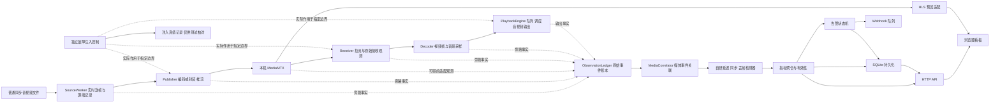
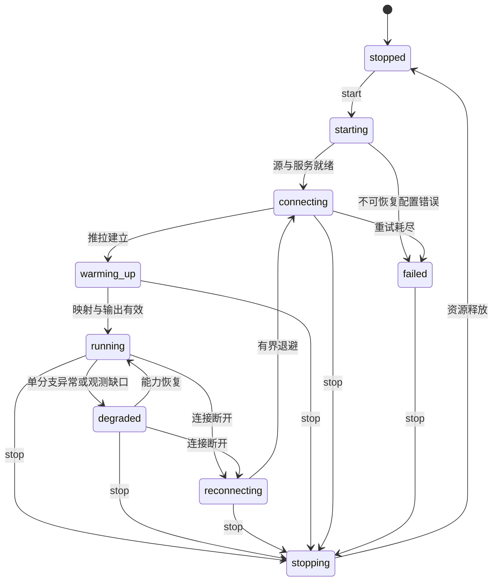

# AVQualityMonitor 系统设计文档

> 版本：v0.1，实施前设计初版。
> 日期：2026-10-27；时区：北京时间。
> 状态：接口、公式及流程为拟实施设计；代码、依赖互通、观测能力、测量精度和性能均尚未验证。
> 依据：[需求与验收基线](./需求与验收基线.md)、[可行性分析报告v0.3](./可行性分析报告.md)、[工作流程与交付计划](./工作流程与交付计划.md)。

## 1. 设计目标与边界

1. 普通音视频素材内容保持不变，不叠字、不插入声音或自定义SEI。正常编解码及封装适配可以进行，但不是为检测植入标记。
2. 源端素材音画同步是输入前提，测量完整链路造成的延迟、播放同步偏差与丢帧，不实现素材口型识别或内容自动修复。
3. 4路表示4条完整源端→推流→服务器→拉流→播放检测链路，默认RTSP 2路、RTMP 2路；8路加分按同样口径扩展。
4. 采集源端、服务器可得信息和接收端原始事件，用自研逻辑计算三类指标，不照搬成品QoS统计。
5. 主指标终点为已定义并验证的软件播放输出观测点。浏览器额外预览链路、显示器发光和扬声器声学传播不包含在主延迟中。
6. 每路均有真实软件输出与观测，不能仅解码或定时等待后宣称已经呈现。预览切换不启停其他链路的检测。
7. 不可测、缺失、预热、不适用与正常数据分别表示；普通素材主验收仍须取得有效检测证据，不能以全部未知替代实现。
8. 业务模块在本机Windows x64、C++20、CMake、MSVC v143环境实现。MediaMTX为外部本机进程；SQLite、HTTP、编解码等职责见可行性报告。

## 2. 总体架构与部署



图中服务器侧观测是待验证适配点，不意味着MediaMTX默认提供逐帧接口。注入控制箭头是备选实验位置，不表示任意网络字节可以安全丢弃。

### 2.1 进程划分

| 进程／资源 | 职责 | 生命周期 |
|---|---|---|
| `avqm.exe` | 管理4／8条链路、播放观测、检测、HTTP、存储及通知 | 统一入口启动，退出前排空关键记录 |
| `mediamtx.exe` | 本机媒体发布与读取，HLS预览 | 启动脚本管理，仅停止本次启动的子进程 |
| Chrome／Edge | 总览、详情、历史、配置及额外预览 | 浏览器关闭不终止检测 |
| 本地Webhook接收端 | 演示通知，可由主程序独立路由或测试工具提供 | 测试／演示启用，不依赖云服务 |
| SQLite及日志目录 | 指标、事件、配置审计和观测段 | 相对项目数据目录，启动前校验容量及写权限 |

主程序内部通过受控事件队列共享两端记录，避免额外分布式时钟问题。协议本身仍经真实套接字与本机服务器。未来跨机器部署需新增时钟同步和旁路传输设计，不自动沿用本机精度结论。

### 2.2 拟定目录与构建入口

```text
src/app/             启动、组合与服务管理
src/config/          配置解析、校验与版本
src/media/           源端、推拉流、编解码与协议适配
src/playback/        音视频输出、队列和设备时钟
src/observation/     原始事件、时间映射和关联
src/detection/       三类自研检测与聚合
src/alerts/          告警与Webhook
src/storage/         SQLite、观测段和清理
src/http/            API、静态资源和请求校验
src/testing/         故障注入、真值记录及核对工具
web/                 本地网页与已锁版前端依赖
tests/               单元与集成测试
config/              示例配置和本机服务器配置
scripts/             构建、启动、停止与验证入口
docs/                需求、可行性、设计、测试及演示文档
```

拟提供`cmake --preset windows-release`、`cmake --build --preset windows-release`、`ctest --preset windows-tests`和`./scripts/start.ps1`。这些是接口计划，尚不可执行；实现后用实际复现命令更新README。构建和运行不临时联网获取`latest`依赖。

## 3. 核心模块与接口契约

| 模块 | 输入 | 输出／职责 | 主要约束 |
|---|---|---|---|
| ChainManager | 配置、用户操作 | ChainSession及任务控制 | 推拉配对、隔离、幂等停止 |
| SourceWorker | 普通文件、实时节奏 | 媒体单元、源端时间记录 | 不改内容；保留原有音视频对应关系 |
| Publisher／Receiver | 媒体或URL | 编码／协议I/O及原始事件 | 中断与超时，协议差异封装在适配层 |
| PlaybackEngine | 解码帧／采样 | 输出观测、丢弃与音频进度 | 输出线程拥有设备，不能用队列入队代替播放 |
| ObservationLedger | 各阶段不可变事件 | 可检索的有界原始记录 | 丢记录须显式标记观测间隙 |
| MediaCorrelator | 源收媒体事实 | 关联结果、时间映射与置信状态 | 不依赖注入真值，不硬按序号配对 |
| Detectors | 已关联观测／原始协议证据 | 指标与帧结局 | 自研公式、去重、窗口及归因 |
| MetricAggregator | 检测样本 | 1秒快照、滚动统计 | 有效样本覆盖和分母一起输出 |
| AlertEngine | 指标及规则版本 | 告警发生／升级／恢复事件 | 缺失数据不视为恢复 |
| Repository | 快照与事件 | SQLite事务和查询 | 单写入，查询不阻塞媒体线程 |
| ConfigService／HTTP | JSON及控制请求 | 配置事务、快照和命令结果 | 数据校验、并发版本校验、异步命令 |
| FaultInjector | 独立测试配置 | 真实延后／丢弃动作、真值记录 | 检测模块不可读取其决策日志 |

拟定C++接口形状如下，仅定义职责，不是本次已实现源码：

```cpp
struct IObservationSink {
    virtual bool try_publish(Observation event) = 0;
    virtual ~IObservationSink() = default;
};
struct IMediaCorrelator {
    virtual void ingest(const Observation&) = 0;
    virtual Association lookup(const MediaKey&) const = 0;
    virtual void close_epoch(SessionId, EpochId) = 0;
    virtual ~IMediaCorrelator() = default;
};
struct IDetector {
    virtual void consume(const Observation&, const Association&) = 0;
    virtual MetricSnapshot snapshot(MonoTime now) = 0;
    virtual ~IDetector() = default;
};
struct IPlaybackProbe {
    virtual PlaybackCapabilities capabilities() const = 0;
    virtual PlaybackSnapshot snapshot(MonoTime now) = 0;
    virtual ~IPlaybackProbe() = default;
};
```

任务启停返回命令ID和异步状态，不能让HTTP线程等待连接或重连完成。协议上下文、解码器、设备和文件句柄采用RAII，明确所有权；跨线程传递引用计数媒体对象或移动所有权，不传临时裸指针。

## 4. 数据模型、标识与有效性

### 4.1 标识及原始事件

| 字段 | 含义 |
|---|---|
| `run_id / clock_domain_id` | 本次程序运行及可比较时钟域，不能跨启动直接相减 |
| `chain_id / session_id / epoch_id` | 固定链路、一次连接会话、一次媒体连续性区段；循环／跳变创建新epoch |
| `track / source_unit_id` | 音视频轨及源端内部单元编号；编号不嵌入媒体 |
| `pts / dts / time_base / duration` | 原始媒体字段；保留整数与有理时间基，不早转低精度浮点 |
| `source_media_us / observed_mono_ns` | 统一源媒体位置与事件实际单调时间 |
| `stage / action / local_sequence` | 源送入、编码、发送、接收、解码、呈现提交／完成、丢弃等，支持去重 |
| `payload_signature / protocol_fields` | 可选规范化媒体单元指纹、SSRC／序号／RTP时间等原始证据 |
| `mapping_id / backend / capabilities` | 本次时间映射、播放后端、观测能力与实际字段覆盖 |
| `validity / reason / uncertainty` | 有效性、原因及可解释误差；误差未知不能默认为零 |

源端内部帧号便于账本记录，不是网络协议自带的统一帧号。容器包、RTP包、视频访问单元和解码帧不是同一计数单位，必须保留其一对多／多对一关系。

### 4.2 指标状态

`valid`、`warming_up`、`pending`、`unavailable`、`ambiguous`、`stale`、`not_applicable`分别表示有效、预热、等待结局、能力缺失、关联歧义、过期和不适用。

数值无效时JSON返回`null`，同时附`validity`和原因，禁止`0`、NaN或绿色“正常”掩盖缺测。指标有效性与连接状态、告警等级是三个独立字段。

## 5. 时间模型与不改内容的媒体关联

### 5.1 三类时间

1. **单调观测时间**：Windows QPC为候选，记录原始计数和频率，统一转换到纳秒；同机跨线程／进程的可比条件按官方说明核对。[D1]
2. **源媒体时间**：文件中音视频原有时间关系，经同一个源时间原点转换；保留轨间原始偏移，不将两轨分别归零。
3. **UTC时间**：用于历史查询、日志与API展示，通过运行锚点映射到单调时间；墙钟校准后更新锚点，不改变过去已算出的耗时。

文件在实时送帧进入发送处理链路前记录源端参考，网络／编码背压等待应计入其后耗时。对于压缩直通，该边界是媒体单元实时释放；对于解码再编码，该边界是源端帧实时释放到编码前。两种模式不能混称真实摄像头曝光，须在元数据中明确。

源端按DTS控制压缩包发送节奏、按PTS定义呈现关系；B帧、预读和负DTS按会话锚点管理。不能用文件读取顺序推导展示顺序。FFmpeg原始字段按实际流时间基解释，补算或启发式时间戳单独标记。[D4]

### 5.2 媒体关联策略

优先验证以下组合，不修改素材：

1. 源端记录发送媒体单元的原始PTS／DTS、轨、会话与实际源端时间；接收端保留对应原始字段和解码关系。
2. 用服务器可取得的时间映射及协议字段建立源收关系。若只发生可证明的固定平移／缩放，保存分段映射与证据；不能按到达时间拟合映射以消除真正延迟或漂移。
3. 使用规范化压缩访问单元指纹辅助锚定。H.264的起始码／长度前缀等封装变化必须规范化，不能直接比较容器包字节。重复内容必须联合时间和上下文消歧。
4. 源端转码前后通过编码器输入输出及时间字段关联，不能假设输入帧与压缩包一一对应；必要解码内容比对仅作为候选辅助，不能保证任意转码结果哈希相等。
5. 每个源端单元只关联到符合会话、轨与映射约束的接收事件。多解、失配及缺证据均标明，不按第N个接收帧硬配第N个源帧。

关联结果返回`source_unit_id、mapping_id、evidence_ids、status、uncertainty`。唯一关联、合理时间区间和实际输出证据齐全才产生主延迟样本。关联覆盖率与歧义数作为测量可信度信息，属于对三类指标的解释，不扩展质量维度。

### 5.3 源端与服务器观测边界

`publish_call_success`只证明库调用成功，不自动证明远端收齐或呈现。服务器日志／成品统计只作辅证；逐帧转发证据如缺失，需最小原始观测适配、受控边界或FFmpeg观测补丁。适配仅导出事实，计算仍自研。

源、服务器、接收任一阶段漏记录时标记该区间`observation_gap`，相关归因降级为未知；不能把本程序丢事件当网络丢帧。

## 6. 播放输出与音视频同步模型

### 6.1 输出架构

- 每条链路有独立播放队列与状态。初版拟使用一个本机监测输出窗口，为每路分配独立渲染面，共享输出线程；窗口布局属于主测量输出，不等于已经完成浏览器宫格加分项。
- 每次合成输出记录哪些链路真正提交了新帧；重复显示旧帧不能记成该链路又呈现一帧。若输出有完成反馈，将反馈与合成帧号和各路媒体单元关联。
- 最小化、遮挡、设备丢失或后端不反馈完成时，按实际能力处理，不用隐藏窗口或空输出冒充已呈现。
- SDL3为便捷输出候选；若仅有提交返回，则明确`video_submit`观测级别，不能直接发布为主呈现完成。V-02需确认可接受终点，必要时接入DXGI完成／统计信息；其支持条件和计数映射必须实测，DXGI调用次数不等于实际显示次数。[D3]
- 音频每路保留独立的样本时间映射，统一混音输出，只有用户选中路默认可听，其他路可零增益；仍需真实进入共享输出消费路径。不能用静音、零增益或音频断开替代“有可验证音频播放进度”。
- 混音时间与各轨样本映射须保留重采样、补静音、欠载和丢弃段。设备时钟只代表共享输出进度，不能把全局播放字节数直接当成每路源媒体进度。
- SDL音频接口不足以取得可信消费时钟时，评估WASAPI `IAudioClock`等接口；按其设备频率解释位置和QPC关联，不能当作源媒体采样数直接使用。[D2]

本机4路实际输出方案是V-02的实施候选，尚未验证，不预先保证SDL或DXGI在当前窗口模式下提供所需精度。

### 6.2 正常同步策略与诊断

正常播放器依据统一媒体时间轴调度，必要时按已写明规则等待／丢弃过期视频帧或处理音频欠载。所有自动修正记录为原始播放事件。

检测器观察最终实际输出，不采用故意关闭同步来制造错误的默认模式。若缓存吸收了注入的上游延后而最终声画仍对齐，应报告同步正常、总延迟或缓冲增加；不能强行显示设定偏差。验证最终不同步时，可在同步调度后对某分支施加明确、独立的输出延后，真实结果仍由观测计算。

## 7. 三类指标的口径、公式与窗口

### 7.1 指标总表

| 指标 | 观测位置／计算基础 | 窗口与刷新 | 单位 | 默认阈值 |
|---|---|---|---|---|
| 端到端延迟 | 同一媒体事件源端实时释放→软件呈现完成 | 每有效帧采样；1秒均值／最大／分位数，近5分钟图每秒刷新 | ms | >400预警，>1000严重 |
| 音画偏差 | 同一观测时刻的音频已播放源位置与已呈现视频源位置 | 输出事件／音频时钟更新；1秒输出中位及最大绝对偏差 | ms | >+45或<−125告警；>+90或<−185严重 |
| 同步漂移 | 有效音画偏差对单调时间的斜率 | 60秒窗口，每秒更新；有效覆盖至少80%，未覆盖满窗口预热 | ms/s | 绝对值>1持续30秒预警 |
| 主视频丢帧率 | 已确定结局的源端应发送视频帧及实际结局 | 源时间10秒窗口，成熟后发布，每秒刷新；实时另列pending数 | %、帧 | >1%预警，>5%严重 |
| 传输／解码／呈现分项 | 同一应发送帧的互斥结局 | 与主丢帧窗口一致 | 帧、% | 用于归因；不重复计入总数 |
| 连续丢帧 | 源展示顺序中的连续未正常呈现帧 | 当前窗口及本会话最大值 | 帧 | 展示证据，不另编统一标准 |
| 冻结 | 新视频实际呈现间隔 | 最近30个已完成间隔作基线，当前停顿实时计时 | ms、次数 | 动态冻结判据；持续1秒严重 |

阈值依据沿用需求基线：音画偏差参考BT.1359-1；延迟为参考G.114的低延迟演示策略；丢帧、漂移、防抖为项目初值，不冒称通用强制标准。单位、窗口及报警用统计量随配置保存版本。

### 7.2 端到端延迟

```text
L_i_ms = (T_video_present_i_ns - T_source_release_i_ns) / 1,000,000
```

两时间必须处于同一可比较时钟域，且关联同一视频帧。不得用解码完成、播放计划时间、源文件PTS或告警注入参数替代。负值、关联歧义或输出能力不足时样本无效，不夹成零。

分段耗时只在相邻原始边界均存在且可关联时输出，标注边界。主延迟不靠分段估计相加得到。初版告警统计量拟采用1秒内有效帧延迟均值，最大及P95用于解释；该选择是待验证实现策略，界面明确标注，后续调整需版本化。

### 7.3 音画偏差与漂移

令`A(t)`为音频设备在时刻t已消费到的源媒体位置，`V(t)`为同一时刻已确认呈现画面对应的源媒体位置，两者已映射到同一源时间轴：

```text
Delta_av(t)_ms = A(t)_ms - V(t)_ms
```

正值表示音频超前，负值表示滞后。例：声音已到10.100秒、画面仍为10.000秒，偏差为+100ms。源端两轨原有起点偏移保留在统一时间轴，不能再任意扣除正常偏差。

视频离散帧的保持区间和音频查询时刻造成量化误差；优先在确认的视频呈现时刻查询／插值有效设备时钟，限制插值间隔并记录不确定度，避免把1秒轮询时差当音画偏差。没有可信设备进度时同步指标不可测，不能用音频队列入队位置补值。

60秒斜率使用线性拟合`Delta_av = b + k*t`，t单位秒，k单位ms/s。输出样本数、覆盖率和拟合残差；帧丢失、时钟不连续及会话切换不硬拟合。固定错位表现为b变化，稳定漂移表现为k持续非零；两者可同时发生。

### 7.4 丢帧分母、结局与等待

主统计集合E为源端在指定媒体区间内释放、应由本链路发送的视频帧。源端主动跳帧、源编码失败单独记录，不混入“已实际发送后传输丢失”；可作为E中的未呈现结局独立分类。

每帧最终结局互斥：`presented_ok`、`source_skipped`、`encode_or_send_failed`、`transport_lost`、`decode_failed`、`presentation_dropped`、`unknown_missing`。`pending`尚未确定，不算最终丢失。解码损伤但仍呈现另加损伤注记，不因像素可疑就重复增加丢帧数。

```text
N_expected_final = E中已确定结局的帧数
N_missing_final  = 其中未正常呈现的帧数
loss_pct = 100 * N_missing_final / N_expected_final
```

各原因占比用同一分母，求和等于主缺失比例；另给只针对实际发送帧的传输损失占比，分母与主指标不同，字段与界面必须区分。分母为零时返回null。

源时间窗口的结局需等待乱序、缓冲及播放机会。设计可配置`frame_resolution_timeout_ms`与重排等待上限；初始建议5秒，须结合最大正常缓冲和实验预先核定，不能因到达瞬时超时就宣告网络丢失。超时仅能形成`unknown_missing`，有明确丢弃／失败证据才给具体归因。

窗口必须附`provisional/final`、pending数、源时间边界和版本。达到超时后迟到的帧仍保留late事件，更新对应窗口版本及审计，不静默重复计数；告警事件保留其当时采用的指标版本。最终演示需等待窗口成熟再对照精确数量。

### 7.5 冻结与连续丢帧

```text
freeze_threshold_ms = max(3 * mean(last_30_intervals),
                          mean(last_30_intervals) + 150)
```

基线使用当前停顿之前已完成的新帧呈现间隔，不将当前长间隔先纳入平均。启动期不足30个间隔时用配置帧率辅助预热并标注；逐帧观测，不能每秒才判断一次。停顿达到阈值记录冻结开始，恢复时完成事件；实时显示自上一新帧以来的停顿时长，事件中分别保存总间隔及超阈值部分，避免“冻结时长”含义混乱。

主动暂停／停止／设备不可用／断连是单独状态；检测缺失输出时保留中断事实，不谎报持续正常。连续丢帧按源PTS展示顺序统计，重复包不新增帧，跨会话不拼接。静态画面持续呈现不同帧不判内容冻结。

## 8. 协议与方向差异、归因证据

| 路径 | 可用证据及所需适配 | 禁止的简化 |
|---|---|---|
| RTSP UDP拉流 | RTP序号扩展／回绕、SSRC、RTP时间、乱序窗口、访问单元组装；结合源端及服务器边界记录 | RTP序号缺口直接当同数量视频帧缺失；最后一次收包后无限推测应收包数 |
| RTSP TCP拉流 | RTSP交织RTP记录、应用接收与解码／播放边界，观察重传后实际交付 | 将TCP重传当最终视频丢帧，或用等待过长直接证明网络丢帧 |
| RTMP拉流 | 完整媒体消息／访问单元时间字段、源收关联及解码／播放事件 | 把FLV标签、TCP分段、压缩包数量都当视频帧数 |
| RTSP／RTMP推流 | 源端、编码、封装调用、发送边界及可取得接收反馈 | “写入成功”等于服务器收到或远端呈现 |
| 未管理外部源 | 接收、解码和输出事实，按实际参考能力计算 | 无源端信息仍输出伪造绝对延迟；将缺测值当零 |

至少两类基础归因必须实际证明：

- `transport_lost`：存在已进入相关传输边界的媒体单元证据，以及该边界另一端损失／组装缺失的证据；若服务器与网络段无法区分，只能报告明确范围的交付缺失和不确定性，不能武断标网卡丢包。
- `presentation_dropped`：同一帧已被解码并进入可播放状态，但播放队列或渲染端记录明确丢弃，未成功呈现。

上游损失导致下游解码失败时，以最早有充分证据的根因计一次，其他影响附加记录。无证据的缺失归`unknown_missing`。服务器自身限流、队列丢弃应显示其边界，不能伪装为网络包损失。

UDP／TCP低层字段若FFmpeg公开接口不足，V-03阶段比较原始观测补丁与受控代理；不能只根据FFmpeg错误日志字符串归因。方案未选定前协议适配层保持接口，不声称归因已完成。

## 9. 并发、生命周期、隔离与背压

### 9.1 线程与任务模型

- 每条链路独立Source/Publisher任务、Receiver任务及解码处理任务；可在负载验证后合并轻量步骤，不预设“每包新线程”。
- 渲染和音频设备由指定输出线程管理，链路队列分别有界；某条欠载或过载不能阻塞其他条。
- 观测／检测按chain_id分片串行处理，保持同链路状态一致；跨线程事件可能乱序，用事件时间、阶段与本地序号处理，不假设队列到达顺序等于媒体顺序。
- 全局独立数据库写线程、Webhook工作队列、HTTP有限线程池与低频清理任务。HTTP／通知／磁盘I/O不进入媒体实时路径。
- 视频播放队列初值最多6帧，压缩接收队列同时限制字节数和时长，音频队列按毫秒上限控制；具体初值在V-06前确定并记录。满队列的选择及丢弃必须产生事实事件。
- 关键观测队列溢出时保存缺口状态并降低指标有效性，不为保住曲线而无限占用内存。

### 9.2 链路状态机



启动先验证配置、服务和输出能力，再建立推流并等待流可读，随后启动对应拉流，不能以固定sleep假定服务器已就绪。重连创建新session，文件循环／时间跳变创建新epoch并清空相应映射；不将正常循环当持续漂移。

停止先停止源生成，取消阻塞I/O，排空或显式结束未定结局，释放编解码和输出资源，再提交状态。所有停止操作幂等且有超时，单条重启不重置其他链路。进程崩溃后的未完成会话下次启动标为aborted，不写“正常恢复”。

## 10. 故障注入设计

注入仅作为测试／演示功能，默认关闭，按链路启停，状态清楚显示。配置包括`mode、boundary、seed、probability、burst_length、start_after_ms、duration_ms、delay_ms、drift_ms_per_s`，校验作用范围与互斥项。

| 模式 | 实际动作 | 真实性与验证 |
|---|---|---|
| UDP随机／突发丢包 | 在经过验证的RTP传输适配边界抑制指定包 | 记录包身份，检测端从自身序号／组装证据发现，不读取注入答案 |
| 媒体转发丢帧 | 在能安全识别完整访问单元的边界丢弃 | 保持协议语法有效，依赖帧损伤可出现，不能删除TCP任意字节 |
| 呈现丢弃 | 将已解码待呈现帧交给实际丢弃路径 | 正常播放事件反映丢弃事实，但不附注入决策供检测作弊 |
| 延迟／同步漂移 | 对选定边界真实排队或延后输出 | 媒体时间关系不靠修改前端数值伪造；记录实际执行而非只记计划 |
| 源端跳帧 | 发送前跳过指定源帧 | 单列源端原因，不冒充网络传输丢失 |

FaultInjector与TruthRecorder依赖仅存在于测试控制层。检测器可见正常源参考和真实媒体路径事件，看不到“计划损失5%”或故障根因决策。后置核对工具比较注入记录、检测结果和实际附带影响；注入包数量不直接等于缺失帧数量。固定种子复现决策，不保证系统调度和网络后果逐次相同。

## 11. 告警、通知与配置生效

### 11.1 告警状态

`normal → pending → warning/critical → recovering → normal`，升级记录事件；恢复后再次越界形成新episode。普通越界持续3秒触发、持续正常3秒恢复；冻结持续1秒、漂移持续30秒采用各自规则，不再叠加普通3秒。

数据不可测／过期不能当正常清除告警，而标记告警观测中断；链路停止关闭episode并写`ended_by_stop`，不是指标恢复。短时异常原始事件始终记录，通知防抖不抹掉检测事实。

每个episode有稳定ID和规则版本，发生、升级、恢复产生不同事件ID。Webhook至少一次投递语义，接收方可按event_id去重；初值3次有限重试（1／2／4秒退避）、3秒单次超时，最终失败落库并展示。Webhook错误不改变媒体质量等级。

### 11.2 配置及变更

JSON配置分为`server、chains、playback、metrics、alerts、storage、logging、fault_injection`。每条链路包含源文件、别名、协议、RTSP传输、发布与拉取URL、是否音频、实时节奏、重连策略。

- 阈值、告警持续时间与日志级别：校验后立即生效，重置相应pending计时但保留已发生事件和原始快照。
- 源地址、协议、播放设备及关联策略：通过异步重启受影响任务生效，界面显示命令结果。
- 保留策略：下次清理周期执行；媒体录像有独立容量及期限上限。
- 帧结局超时、窗口及时间模型变化：新统计版本／区段生效，不能重解释旧数据却不改版本。

更新使用revision比较，原子写临时文件再替换配置；写失败不发布新配置。记录修改时间、字段和执行结果。API隐藏凭据，日志不打印含密码的完整URL。

## 12. 持久化、历史查询与日志

| 表／记录 | 主要字段及用途 |
|---|---|
| `runs / chain_sessions` | 运行、时钟域、链路、源信息、epoch、开始结束和终止原因 |
| `metric_samples` | chain/session、单调与UTC区间、窗口版本、数值、有效性、分母、pending和误差 |
| `frame_outcomes` | 原始事件／证据引用、互斥结局、源媒体位置和迟到更正；可采用分段文件而非逐帧全部常驻SQL |
| `events / alert_episodes` | 检测异常、阶段原因、告警发生升级恢复和规则快照 |
| `webhook_deliveries` | event_id、尝试次数、时间、结果和下次重试 |
| `config_revisions / observation_segments` | 配置审计、旁路观测段索引、缺口、哈希与可用时间范围 |

SQLite采用单写入队列、事务批写、WAL、busy timeout及按链路／UTC时间索引；历史读取独立连接，不持有长事务阻碍检查点。实时快照来自内存聚合，不能每次为网页扫描全部历史。7天保留指标、事件和日志；逐帧旁路记录另设容量与保留策略，并明确已删除段影响复算能力。

清理先核对文件归属与绝对路径，避免误删项目外数据；优先关闭录像段再清理，保留索引一致性。媒体初始建议10GiB总量或30分钟先到者清理，实际值根据磁盘与复盘需要锁定。WAL数据库备份通过一致性备份流程，不只拷贝活动`.db`文件。

历史接口支持近1／6／24小时和任意起止时间，UTC区间采用`[from,to)`，界面显示北京时间。长区间按请求分辨率聚合，曲线保留异常峰值、缺口与有效覆盖；不可跨会话直接连接曲线。事件分页，查询条数和范围设上限。

运行日志记录连接、退出、异常、配置和通知结果，按级别与大小轮转。高频逐帧证据写旁路段而非刷满普通日志。没有保留足够证据的时段不能承诺事后重算。

## 13. HTTP API及网页交互

默认仅监听`127.0.0.1:8080`，服务静态资源、API和本地预览访问配置；端口冲突明确失败，不终止未知进程。跨端口预览的CORS／代理配置在V-07验证。所有前端资源本地打包，不依赖CDN。

| 方法与路径 | 用途 |
|---|---|
| `GET /api/v1/health` | 服务、数据库、媒体服务器及依赖就绪状态 |
| `GET /api/v1/chains` | 链路状态、推拉配对信息与最新指标 |
| `POST /api/v1/chains/{id}/start|stop|restart` | 返回202与command_id，查询执行结果 |
| `GET /api/v1/commands/{id}` | 异步命令状态 |
| `GET /api/v1/chains/{id}/metrics` | from/to、分辨率、实时或历史窗口，含单位及有效性 |
| `GET /api/v1/events` | 链路、类别、等级、时间范围及分页 |
| `GET /api/v1/config`、`PATCH /api/v1/config` | 脱敏配置与revision条件更新 |
| `GET /api/v1/chains/{id}/preview` | 预览能力、URL及主测量边界说明 |
| `POST /api/v1/chains/{id}/fault-injection` | 测试模式启停；默认不注入，显式显示活动状态 |

成功响应有`schema_version、request_id、data`；错误含稳定code、可读message和字段错误，不泄露堆栈或凭据。400为格式／字段错误，404为资源不存在，409为版本／生命周期冲突，503为依赖未就绪。

本机控制接口仍需检查Origin／Host并使用启动令牌保护写操作，避免任意网页修改配置；默认不向局域网暴露。令牌不作为媒体检测算法依赖。

网页总览每秒轮询，一路一卡显示链路状态、主指标和红黄绿等级；不可测使用独立灰色及原因。详情三张趋势图、归因与冻结／漂移、事件列表和单路有声画预览。近5分钟实时缓存与历史查询分开，长时间范围按需加载，关闭预览释放浏览器播放资源但不停链路。

浏览器HLS预览属于额外输出，应在界面注明“主指标观测：本机软件播放输出”，不能声称网页画面延迟就是主指标。若HLS等待不能满足现场使用，评估MSE适配，不以图片轮询替代正常播放。

## 14. 扩展点与加分项设计

| 加分项 | 扩展点与验证 |
|---|---|
| HTTP-FLV／WebRTC拉流 | 实现Receiver适配及原始时间／媒体关联，纳入相同检测接口；不是仅增加播放按钮 |
| 推流侧质量观测 | 使用源端／发送及远端反馈证据单独展示，缺远端呈现时不伪造端到端结果 |
| 时钟偏差分析 | 独立时钟模型输出估计与假设，不替换主实测延迟 |
| 独立音画交叉验证 | 第二条独立观测／校准路径；专用测试信号仅用于额外验证，不作为普通素材正式前提 |
| 8路完整链路 | ChainManager扩容到8推＋8拉，实际验证编码、解码、输出、存储和预览负载 |
| 离线复盘 | 媒体段＋旁路观测＋配置／规则版本重放，缺历史证据时标明不可重建，不宣称仅录像能重算网络与呈现事实 |
| 浏览器宫格预览 | 多个预览实例，验证额外资源；本机主测量输出的布局不自动等同此加分完成 |

## 15. 设计验证、实施顺序与需求覆盖

### 15.1 先验证再固化的决策

| 决策 | 关联风险 | 进入正式实现的条件 |
|---|---|---|
| 不改素材的源收关联 | V-01 | 普通文件跨3种传输路径可匹配且歧义可见，不能依赖植入标记 |
| 播放终点与音频消费时钟 | V-02、V-04 | 能解释并实测输出事件，不以预定时间／提交数量代替完成 |
| UDP包层及TCP／RTMP边界观测 | V-03、V-05 | 取得必要原始数据，并验证传输与呈现归因 |
| 窗口、超时与队列初值 | V-06、V-08 | 延迟／乱序／重连实验不引起伪丢帧或串会话 |
| 预览、存储与离线打包 | V-07、V-09、V-10 | 浏览器播放、历史、慢I/O隔离和无联网启动可复现 |

未通过的具体后端／映射策略必须修订设计，不能“设计文档写过”就视为实现可行。P0验证后形成v0.2，给出实际接口、精度预算和确定参数；模块实现时同步更新后续版本。

### 15.2 测试与交付安排

1. 先验证工具链和协议互通，再验证源收映射与输出时钟；建立原始证据样例。
2. 核心单测覆盖时间基换算、B帧／重复／缺失、去重与互斥归因、窗口成熟／迟到更正、漂移拟合和告警状态机。
3. 单路真实链路分别复现高延迟、音画固定错位与漂移、UDP包损失和呈现丢弃，核对普通素材结果与独立注入真值。
4. 扩展4条完整链路，单路损伤验证隔离，测试重连／文件循环／输出设备变化、历史与Webhook。
5. 基础完整后再推进加分项；执行1小时稳定性、资源诊断、Chrome／Edge与离线启动演练。
6. 测试计划及实际记录另建文档；当前设计不包含任何“测试已通过”的结论。

| 需求组 | 主要设计章节 |
|---|---|
| T、F：工程与完整推拉链路 | 2、3、8、9 |
| M、L：原始观测与端到端实测 | 4、5、6、7.1～7.2 |
| A：源端同步关系与接收端偏差 | 5、6、7.3 |
| D：丢帧归因、连续丢帧与冻结 | 7.4～7.5、8 |
| E：告警与对外通知 | 11、12 |
| W：预览、看板、配置与历史 | 11～13 |
| N、I：稳定性、独立故障注入与验证 | 9、10、15 |
| B：8项加分 | 14 |
| O、P：文档、Git、期限与现场交付 | 本文及工作流程；后续测试记录与演示指南 |

## 16. 资料与修订记录

技术选型与阈值来源详见需求基线及可行性报告。下列官方资料于2026-10-27核对，用于约束接口语义；本报告拟定的架构与算法属于本项目设计，不是这些接口保证可行的结论。

- [D1 Windows高分辨率时间戳](https://learn.microsoft.com/en-us/windows/win32/sysinfo/acquiring-high-resolution-time-stamps)：QPC及同机比较条件。
- [D2 IAudioClock::GetPosition](https://learn.microsoft.com/en-us/windows/win32/api/audioclient/nf-audioclient-iaudioclock-getposition)：设备位置、频率与对应QPC时间语义。
- [D3 DXGI_FRAME_STATISTICS](https://learn.microsoft.com/en-us/windows/win32/api/dxgi/ns-dxgi-dxgi_frame_statistics)：呈现计数、显示次数和时序统计区别。
- [D4 FFmpeg libavformat接口定义](https://github.com/FFmpeg/FFmpeg/blob/master/libavformat/avformat.h)：媒体包时间字段语义；实际实现以锁定发行版本为准。

| 版本 | 日期 | 内容 |
|---|---|---|
| v0.1 | 2026-10-27 | 实施前架构、接口、时间与关联模型、软件输出、指标公式及窗口、协议归因、并发、注入、API、存储与验证门槛；未实现、未实测 |
